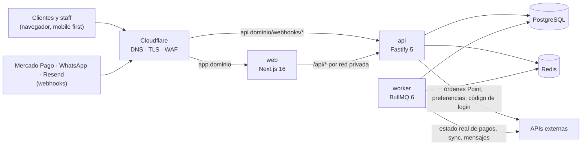
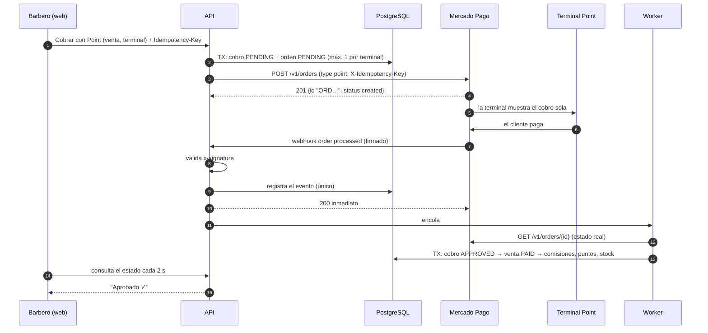
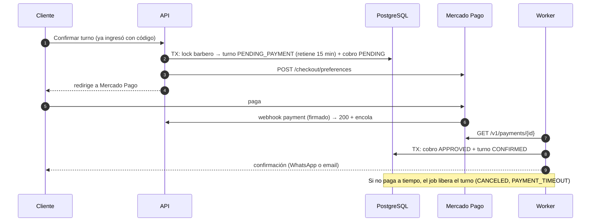

# 01 · Arquitectura

> Propuesta de la Fase 0. Todo lo marcado como **Decisión** puede discutirse en la revisión; la tabla completa está al final (§17).

## 1. Vista general



| Servicio                      | Responsabilidad                                                                                                                                                             | Instancias                 |
| ----------------------------- | --------------------------------------------------------------------------------------------------------------------------------------------------------------------------- | -------------------------- |
| **web** (Next.js, App Router) | Toda la interfaz: panel admin, panel barbero, portal del cliente y página pública de reservas. **No tiene lógica de negocio ni acceso a la base**: todo pasa por la API.    | 1 (escalable)              |
| **api** (Fastify)             | Autenticación, validación con Zod, autorización por rol **y** sucursal, reglas de negocio, recepción de webhooks. Sin estado en memoria.                                    | 1+                         |
| **worker** (BullMQ)           | Procesa webhooks encolados, envía notificaciones y corre los jobs programados (sync de Mercado Pago, recordatorios, liberación de señas, vencimiento de puntos, monitoreo). | **1** (y todo idempotente) |
| **PostgreSQL**                | Única fuente de verdad.                                                                                                                                                     | Railway + backups          |
| **Redis**                     | Colas y rate limiting. **No es fuente de verdad**: si se pierde, todo se reconstruye desde la base.                                                                         | Railway                    |

La lógica de negocio vive en un paquete compartido (`packages/core`) que usan tanto la API como el worker. Así, "marcar una venta como pagada" es el mismo código si lo dispara un cobro en efectivo (API) o un webhook de Mercado Pago (worker).

## 2. Versiones (fijadas, no "latest")

| Pieza                           | Versión                                                                                                                                         | Por qué esta                                                                                                                                                                                                                                                        |
| ------------------------------- | ----------------------------------------------------------------------------------------------------------------------------------------------- | ------------------------------------------------------------------------------------------------------------------------------------------------------------------------------------------------------------------------------------------------------------------- |
| Node.js                         | 24 LTS                                                                                                                                          | LTS vigente hasta 2028. La 26 pasa a LTS en octubre 2026; se evalúa después.                                                                                                                                                                                        |
| pnpm                            | la misma mayor que el otro proyecto (si no hay preferencia, 12.x)                                                                               | Un solo flujo de trabajo entre proyectos.                                                                                                                                                                                                                           |
| TypeScript                      | **6.0.x**                                                                                                                                       | TS 7 (el compilador nuevo en Go) salió en julio 2026 pero todavía no tiene API programática y typescript-eslint no lo soporta. Se puede sumar TS 7 solo para chequear tipos más rápido.                                                                             |
| Next.js / React                 | 16.3 / 19.3                                                                                                                                     | Estable actual. `middleware.ts` ahora se llama `proxy.ts`.                                                                                                                                                                                                          |
| Tailwind / shadcn/ui            | 4.x / CLI 4.x                                                                                                                                   | Estable actual.                                                                                                                                                                                                                                                     |
| Fastify                         | 5.12                                                                                                                                            | Estable actual.                                                                                                                                                                                                                                                     |
| Zod / fastify-type-provider-zod | 4.6 / 7.0                                                                                                                                       | La v7 del provider exige Zod ≥ 4.2 y trae `@fastify/swagger` (documentación OpenAPI automática).                                                                                                                                                                    |
| Prisma                          | **7.10.x exacto**                                                                                                                               | Ojo: `npm i prisma` hoy instala la **8.0 RC** (el tag `latest` apunta a la RC a propósito). Prisma 8 es una reescritura (otro formato de schema, sin `PrismaClient`) con salida estable prevista para octubre 2026. Prisma 7 tiene soporte 18 meses después de eso. |
| BullMQ + ioredis                | 6.3 + **ioredis 5.x**                                                                                                                           | ioredis 6 cambia el protocolo por defecto y tiene un problema de tipos abierto con BullMQ 6.                                                                                                                                                                        |
| PostgreSQL                      | 16+ (la que ofrezca Railway, hasta 18)                                                                                                          | Validado localmente en 16.                                                                                                                                                                                                                                          |
| Otras                           | argon2 (argon2id), date-fns 4 + @date-fns/tz, libphonenumber-js, pino, React Email, TanStack Query/Table, react-hook-form, Vitest 5, Playwright | Estándar del ecosistema.                                                                                                                                                                                                                                            |

## 3. Cómo se comunican la web y la API — **Decisión D1**

- El navegador **solo habla con `app.<dominio>`**. Las llamadas van a `app.<dominio>/api/...` y un _route handler_ de Next las reenvía a la API por la **red privada de Railway** (`api.railway.internal`), agregando la IP real del cliente, un `request-id` y un secreto interno.
- Los Server Components llaman a la API directo por la red privada, reenviando la cookie.
- La API tiene dominio público (`api.<dominio>`) **solo para `/webhooks/*` y `/health`**. Cualquier otra ruta pedida por el dominio público responde 404.
- **Cookies:** `__Host-est_staff` y `__Host-est_client` (una persona puede ser barbero y cliente a la vez). `HttpOnly`, `Secure`, `SameSite=Lax`, sin `Domain`: la cookie queda atada a `app.<dominio>`.
- **CSRF:** mismo origen + `SameSite=Lax` + la API exige `Content-Type: application/json` y valida `Origin` en toda mutación.

**Por qué:** un solo origen (sin CORS), la cookie más restrictiva posible, la API de negocio no queda expuesta a internet y el esquema funciona igual el día que una franquicia o marca tenga su propio dominio.
**Alternativa descartada:** API en subdominio con CORS y cookie compartida en `.dominio`. Es más directa, pero comparte la cookie entre subdominios y expone todas las rutas de la API.

## 4. Backend por dentro

```
Ruta HTTP (Fastify)                Job (BullMQ)
  · valida con Zod                   · valida payload con Zod
  · resuelve sesión y permisos       · toma lock del recurso
          │                                  │
          └──────────► packages/core ◄───────┘
                    (servicios de dominio, transacciones)
                              │
                           Prisma ──► PostgreSQL
```

- **Módulos de `core`:** auth, organización, catálogo, equipo, horarios, reservas, clientes, ventas, cobros, caja, stock, comisiones, puntos, mercadopago, notificaciones, auditoría, reportes, sistema.
- **Transacciones:** cada operación de negocio es una transacción de Prisma. **Nunca** se llama a una API externa (MP, WhatsApp, email) dentro de una transacción de base.
- **Efectos externos por "bandeja de salida":** la operación deja una fila (`notifications`, `webhook_events`) en la **misma** transacción. El worker la procesa. Si el proceso se cae entre medio, nada se pierde: un barrido periódico retoma lo pendiente.
- **Errores:** errores de dominio tipados → HTTP (409 "ese horario ya no está disponible", 422 validación, 403 sin permiso) con mensajes en español para mostrar tal cual.
- **Dinero:** `bigint` en centavos de punta a punta. En JSON viaja como número entero; es seguro porque el límite es 2^53 centavos.
- **Fechas:** UTC en la base. La zona de negocio (`America/Argentina/Buenos_Aires`, guardada por sucursal) se aplica con `@date-fns/tz`. Los horarios semanales se guardan como "minutos desde las 00:00 hora local".
- **Idempotencia de la API:** los endpoints de plata (cobrar, crear venta, pagar liquidación, reintegrar) aceptan un header `Idempotency-Key`. Un doble clic o un reintento de red devuelve la misma respuesta y no duplica nada (tabla `api_idempotency_keys`).
- **OpenAPI:** Fastify genera la documentación de la API a partir de los mismos schemas Zod.

## 5. Autenticación

### Clientes: código por email (sin contraseña)

1. Ingresa su email. Siempre se responde "si el email es válido, te enviamos un código", exista o no el cliente, para no revelar quién es cliente.
2. Se genera un código de 6 dígitos con `crypto.randomInt` y se guarda **solo su HMAC-SHA256** (clave `AUTH_CODE_SECRET` + email). Si alguien lee la base, no ve códigos.
3. Vence a los **10 minutos**. Máximo **5 intentos** (el contador se incrementa de forma atómica). Pedir un código nuevo invalida los anteriores.
4. **Rate limits** (Redis): por email 3 cada 15 min y 10 por día; por IP 20 por hora al pedir y 30 por hora al validar.
5. Código correcto → sesión de **30 días**, que se renueva con el uso. Primer ingreso de un email nuevo → se completa nombre, teléfono y consentimientos.
6. El email del código **no pasa por la cola**: la API lo envía directo a Resend, así el login no depende del worker. Queda registrado en `notifications`, sin el código.

### Staff: email + contraseña

- **argon2id** con parámetros OWASP. Rate limit por email+IP (5 cada 15 min) y bloqueo progresivo (`locked_until`).
- **Alta por invitación:** el admin carga email, rol y sucursales. Llega un link de un solo uso (72 h) para definir la contraseña. Se agrega el flujo de **recuperación de contraseña**, que el pedido original no mencionaba pero es imprescindible.
- **Sesión de 7 días** que se renueva con el uso. Desactivar un usuario o cambiarle el rol **cierra sus sesiones al instante**. Por eso las sesiones son opacas y viven en la base, no son JWT.
- **Segundo factor listo:** `users.two_factor_method = EMAIL_CODE` activa un código por email después de la contraseña. Recomendado para admins antes de salir a producción.

### Sesiones — **Decisión D2**

El token es aleatorio (32 bytes) y viaja en la cookie. En la base solo está su SHA-256. `last_seen_at` se actualiza como máximo cada 5 minutos.

## 6. Autorización (rol **y** sucursal, en cada endpoint)

- **Contexto por pedido:** `{ tipo: staff | cliente, organización, rol, sucursales permitidas (o todas), barberId si es barbero }`.
- **Falla cerrada:** cada ruta declara su política. La API **no arranca** si una ruta no la tiene. Hay un test que recorre todas las rutas con cada rol.
- **Sucursal en la URL** (`/v1/branches/:branchId/...`), validada contra la membresía. Los servicios filtran **siempre** por `organization_id` y por las sucursales permitidas, nunca por lo que venga en el body.
- **Matriz propuesta** (se ajusta con las respuestas de [06-preguntas.md](06-preguntas.md)):

| Acción                                               | Dueño (ADMIN, todas) | Encargado (ADMIN, sus sucursales) | Barbero                                                          | Cliente                   |
| ---------------------------------------------------- | -------------------- | --------------------------------- | ---------------------------------------------------------------- | ------------------------- |
| Agenda de la sucursal                                | ✓                    | ✓                                 | solo la suya                                                     | —                         |
| Crear / mover / cancelar turnos                      | ✓                    | ✓                                 | los suyos                                                        | los suyos, según política |
| Cobrar ("Cerrar servicio") y venta de mostrador      | ✓                    | ✓                                 | ✓ sus servicios                                                  | —                         |
| Descuentos manuales, anular ventas, reintegros       | ✓                    | ✓                                 | ✗                                                                | —                         |
| Abrir caja / cerrar caja y egresos                   | ✓ / ✓                | ✓ / ✓                             | ✓ / ✗                                                            | —                         |
| Ajustes de stock                                     | ✓                    | ✓                                 | ✗                                                                | —                         |
| Clientes                                             | todos                | todos                             | ficha completa de los que atendió + búsqueda básica para agendar | su perfil                 |
| Comisiones                                           | todas                | de sus sucursales                 | **solo las suyas**                                               | —                         |
| Servicios, precios, reglas de puntos, notificaciones | ✓                    | ✗                                 | ✗                                                                | —                         |
| Vincular Mercado Pago                                | ✓                    | ✗                                 | ✗                                                                | —                         |
| Conciliación de pagos                                | ✓                    | ✓ sus sucursales                  | ✗                                                                | —                         |
| Ajustes manuales de puntos                           | ✓                    | ✓                                 | ✗                                                                | —                         |
| Reportes y dashboard                                 | ✓                    | sus sucursales                    | ✗                                                                | —                         |

- **A futuro (franquicias o varias marcas):** agregar Row Level Security de PostgreSQL por organización como segunda barrera.

## 7. Agenda y disponibilidad

**Cálculo de huecos** (función pura, testeable sin base):
horario semanal vigente del barbero en esa sucursal − bloqueos − cierres de sucursal − turnos activos → intervalos libres → inicios cada `booking_slot_step_minutes` donde entra la duración (con override por barbero) → filtro de anticipación mínima y máxima.
Con **"cualquier barbero"** se asigna el que tenga menos minutos reservados ese día; si empatan, gana el orden definido por el admin.

**Reservar sin doble reserva — Decisión D6.** Hay dos capas:

1. **Lock por barbero** (`pg_advisory_xact_lock`) → se vuelve a validar horario, bloqueos y cierres → insert.
2. **Restricción de la base** `EXCLUDE USING gist (barber_id, rango [inicio, fin))` para los estados activos (pendiente de pago, reservado, confirmado, en curso). Es la garantía final, aunque exista un bug en la app.

**Verificado con dos reservas simultáneas del mismo horario** (PostgreSQL 16):

| Escenario                                  | Resultado                                                                                                                 |
| ------------------------------------------ | ------------------------------------------------------------------------------------------------------------------------- |
| Solo la restricción de la base             | 1 turno creado. El otro pedido falla con **deadlock** (error 40P01) después de ~1 s. Es correcto, pero es un error "feo". |
| Lock por barbero + restricción (propuesto) | 1 turno creado. El otro espera y recibe un **rechazo limpio** (23P01).                                                    |

La API traduce 23P01 y 40P01 a "Ese horario ya no está disponible".

- **Mover o reprogramar** usa el mismo camino (lock + revalidación) y queda en el historial (`appointment_events`).
- **Seña pendiente:** el turno queda `PENDING_PAYMENT` y **ocupa el horario** hasta `hold_expires_at`. Se libera con un job programado a esa hora, más un barrido cada minuto como respaldo.
- **Atención sin turno (walk-in):** se crea un turno `IN_PROGRESS` en ese momento, así la agenda refleja la ocupación.

## 8. Ventas, cobros y caja

**Ciclo de la venta:** `OPEN` → `PAID` (o `VOIDED`).

- **"Cerrar servicio"** crea la venta desde el turno. Copia los servicios **con el precio reservado**, suma productos y propinas, aplica la seña pagada y los canjes de puntos. Después se eligen uno o más medios de pago.
- **Punto único de consistencia — Decisión D9.** Cuando los cobros aprobados alcanzan el total, **en una sola transacción**:
  1. La venta pasa a `PAID` y el turno a `COMPLETED`.
  2. Se generan las comisiones.
  3. Se acreditan los puntos.
  4. Se descuenta el stock.
  5. Se actualizan la primera y última visita del cliente.
  6. Se encolan las notificaciones (puntos acreditados, pedido de reseña).

  O pasa todo o no pasa nada.

**Cómo se confirma cada medio de pago:**

| Medio                                               | Cómo se confirma                                                                                  |
| --------------------------------------------------- | ------------------------------------------------------------------------------------------------- |
| Efectivo, transferencia (con nº de operación), otro | Al registrarlo                                                                                    |
| Point (integrado)                                   | Asincrónico, por webhook (ver §9)                                                                 |
| Point cargado a mano                                | Al registrarlo. Sirve de contingencia si falla la integración, y la conciliación lo cruza después |
| Saldo a favor                                       | Al registrarlo, con lock del cliente para no gastar dos veces el mismo saldo                      |

- **Pagos divididos:** una venta puede tener varios cobros (por ejemplo, parte en efectivo y parte con Point).
- **Anular una venta** (solo admin, con motivo): se reintegran los cobros (efectivo de la caja, reintegro en MP o saldo a favor). En la misma transacción se agregan reversas de comisiones y puntos, se devuelve el stock y se revierten los canjes. Todo queda auditado. Los reintegros parciales de dinero (por ejemplo, un cobro de más) no tocan comisiones ni puntos.

**Caja diaria:** una sola caja abierta por sucursal, garantizado por la base. Esperado por medio de pago:

```
esperado(medio) = apertura (solo efectivo)
                + cobros aprobados en esa caja
                − reintegros pagados desde esa caja
                − egresos pagados desde esa caja
                + aportes − retiros
```

Al cerrar, se carga lo contado por cada medio y la diferencia queda registrada. Para Point, "lo contado" es el cierre de lote de la terminal. **Cerrar la caja** y **pagar una liquidación** (que genera el egreso) quedan auditados.

## 9. Mercado Pago

### 9.1 Vinculación de la cuenta — Decisión D18

- **v1:** el admin pega el _Access Token_ de producción y la clave secreta de webhooks de **su propia aplicación** de Mercado Pago. Se crea desde "Tus integraciones" y hay que activar las credenciales de producción.
- Todo se guarda **cifrado con AES-256-GCM** usando la clave `DATA_ENCRYPTION_KEY` de las variables de entorno, con versión de clave para poder rotarla. Nunca se loguea ni viaja al frontend.
- **A futuro (franquicias):** OAuth con una aplicación nuestra. El token dura 180 días y cada renovación devuelve un refresh token nuevo. El modelo ya lo contempla (`auth_method`, `refresh_token_enc`, `token_expires_at`).
- En el panel de MP se configura la URL `https://api.<dominio>/webhooks/mercadopago` con los tópicos **"Order (Mercado Pago)"** y **"Pagos"**. Para Point **no** se puede indicar la URL en cada orden: solo desde el panel.

### 9.2 Terminales

- `GET /terminals/v1/list` → el admin asigna cada terminal a una sucursal.
- `PATCH /terminals/v1/setup` pasa la terminal a modo **PDV**. Después hay que **reiniciarla**.
- Reglas de MP:
  - Cada terminal debe estar asociada a una "sucursal" y a una "caja" de MP. **Cada caja admite una sola terminal en PDV**, así que va una caja de MP por terminal.
  - Según la documentación, los equipos compatibles son **Point Smart 1 y 2** (ver [riesgo R1](05-riesgos.md)).

### 9.3 Cobro con Point



**Datos de la orden:**

- `external_reference` = `sale_<idVenta>_<intento>`. **Ajuste al pedido original:** MP exige que sea **único por orden** (máximo 64 caracteres, `[A-Za-z0-9_-]`). Si un cobro se rechaza y se reintenta, el id de la venta solo se repetiría. Igual queda el id de la venta adentro, así que se identifica desde el panel de MP.
- El monto viaja como texto con 2 decimales (`"15000.00"`).
- La orden vive `point_order_ttl_minutes` (10 por defecto; MP permite de 30 s a 3 h).
- `X-Idempotency-Key` (UUID v4, vale 24 h): si reintentamos la creación por un corte de red, MP no duplica la orden.

**Estados:**

| Orden en MP (`status` / detalle)   | Estado nuestro                   | Qué ve el barbero                                                               |
| ---------------------------------- | -------------------------------- | ------------------------------------------------------------------------------- |
| `created`                          | pendiente                        | "Enviado al Point". **Se puede cancelar desde el sistema.**                     |
| `at_terminal`                      | pendiente                        | "El cliente está pagando". **Solo se cancela desde la terminal** (regla de MP). |
| `action_required`                  | pendiente                        | "Revisá la terminal"                                                            |
| `processed` / `accredited`         | **aprobado**                     | "Aprobado ✓". La venta se recalcula.                                            |
| `processed` / `partially_refunded` | aprobado (con reintegro parcial) | —                                                                               |
| `failed` / motivo                  | **rechazado**                    | Motivo (ej. fondos insuficientes). Se puede reintentar con una orden nueva.     |
| `canceled`                         | **cancelado**                    | —                                                                               |
| `expired`                          | **expirado**                     | —                                                                               |
| `refunded`                         | **reembolsado**                  | —                                                                               |

Si MP responde `409 already_queued_order_for_terminal` es porque la terminal ya tiene un cobro en espera. La base además impide que el sistema cree dos órdenes pendientes para la misma terminal.

### 9.4 Webhooks (crítico)

1. **Firma, siempre.** El header `x-signature` trae `ts=…,v1=…`. Se arma el texto `id:[data.id];request-id:[x-request-id];ts:[ts];` (el `data.id` sale de la query string y va **en minúsculas** si es alfanumérico; si falta algún dato, se omite ese tramo). Se calcula HMAC-SHA256 con la clave secreta y se compara en tiempo constante. Si no valida → **401** y se cuenta para alertar.
   - La clave se elige según el `user_id` del cuerpo. Usar ese dato antes de validar no es un riesgo: sin la clave de esa cuenta no se puede fabricar una firma válida.
   - **No se rechaza por antigüedad de `ts`.** MP no documenta si los reintentos (cada 15 min) reusan el `ts`, y rechazarlos podría perder un pago. No hace falta: nunca se confía en el contenido y el procesamiento es idempotente.
2. **Idempotencia:** se registra el evento en `webhook_events` con `UNIQUE(proveedor, clave)`.
   - Clave para órdenes: `order:<id>:v<version>`. La orden trae un número de versión que sube con cada cambio.
   - Clave para pagos: `payment:<id de notificación>`.
   - Un webhook repetido no se procesa dos veces.
3. **Responder rápido:** 200 al instante (MP da 22 s) y se encola en BullMQ.
4. **Nunca confiar en el contenido:** el worker consulta el estado real (`GET /v1/orders/{id}` o `GET /v1/payments/{id}`), con lock por recurso, y aplica transiciones idempotentes.
5. **Segunda barrera:** aunque se colara un duplicado, las claves únicas de la base (`payments.mp_payment_id`, `points_entries.idempotency_key`, `commission_entries.idempotency_key`) impiden duplicar un cobro, una venta o puntos.

### 9.5 Redes de seguridad

- **Órdenes sin noticias:** cada 2 minutos se consultan las órdenes pendientes con más de 2 minutos sin webhook.
- **Sync de pagos:** cada 10 minutos, `GET /v1/payments/search`.
  - Parámetros: `range=date_last_updated` desde el cursor menos 15 min de solapamiento, en ventanas chicas porque la paginación de MP tiene tope de 10.000.
  - Upsert por id de MP. Los pagos anteriores a `reconcile_from` (fecha de vinculación) no ensucian la bandeja.

### 9.6 Bandeja "Pagos sin asignar" (conciliación)

Para cada pago de la cuenta:

1. Si su `external_reference` es nuestra (`sale_…` o `dep_…`), se vincula solo.
2. Si coincide con el pago de una orden Point nuestra, se vincula solo.
3. Si no, va a la bandeja con **sugerencias**: mismo monto, ±15 min, misma sucursal o caja de MP, cobros "Point a mano" o transferencias sin vincular.

El admin lo asigna a una venta, a la seña de un turno, a saldo a favor de un cliente, lo marca como **otro ingreso** o lo ignora con motivo. Cada acción queda auditada. Los pagos rechazados no entran a la bandeja.

> ⚠️ **Por confirmar con una cuenta real (Fase 5):** la documentación **no garantiza** que las transferencias entrantes a la cuenta ni los QR estáticos aparezcan en la búsqueda de pagos. La vía documentada para ver _todos_ los movimientos son los **reportes** ("Todas las transacciones"). El diseño permite sumar un segundo importador desde reportes sin tocar el modelo ([riesgo R5](05-riesgos.md)).

### 9.7 Seña online (Checkout Pro)



**La preferencia se arma así:**

- `external_reference = dep_<idCobro>`.
- La preferencia vence junto con la retención del turno.
- Se excluye `ticket` (Rapipago y Pago Fácil, que acreditan en días).
- `binary_mode: true`: el pago queda aprobado o rechazado al instante, nunca pendiente.
- `back_urls` a la página de resultado. **Esa página no confía en los parámetros de retorno**: muestra "procesando" hasta que el webhook confirma.

**Pago que llega tarde** (el turno ya se liberó): si el horario sigue libre, se reactiva el turno. Si no, el monto pasa a saldo a favor (o se reintegra) y se avisa al admin con una alerta.

**Cancelación según la política configurada:**

- Con más de X horas de anticipación → reintegro (`POST /v1/payments/{id}/refunds`) o **saldo a favor**, según lo que se elija en configuración.
- Tarde, o si no vino → la seña se retiene.

Queda para evaluar en la Fase 5 la variante "Checkout Pro vía API de Orders". Unificaría el modelo con Point y es un cambio chico en el schema.

### 9.8 Reintegros, pruebas y herramientas

- **Límites de reintegro:**
  - Órdenes Point: hasta 90 días.
  - Pagos online: hasta 180 días.
  - En los dos casos hace falta saldo en la cuenta, y algunos reintegros de Point piden la tarjeta en la terminal.
  - Por eso el default propuesto para señas es **saldo a favor**.
- **Pruebas sin terminal física:** MP ofrece una terminal virtual (`NEWLAND_N950__SBX0000001`) y un endpoint para simular estados. Toda la Fase 5 se puede desarrollar y testear en sandbox antes de tocar un Point real.
- **MCP oficial de Mercado Pago** (`https://mcp.mercadopago.com/mcp`): existe y conviene conectarlo antes de la Fase 5 (búsqueda en documentación, usuarios de prueba, diagnóstico de notificaciones). Hoy no está conectado en esta sesión.

## 10. Notificaciones

**Capa de canales:**

- Cada canal (`EmailChannel` con Resend, `WhatsAppChannel` con Cloud API) cumple la misma interfaz: _nombre_, _¿puede enviar este tipo a este destinatario?_ y _enviar → resultado_.
- Un **router** decide el orden de canales y el fallback. Sumar un canal (SMS, push) = registrar una implementación nueva. **La lógica de negocio no cambia**: solo pide "notificar al cliente X del evento Y".

**Router:**

1. **Preferencia** del cliente (por defecto WhatsApp).
2. **Consentimiento** vigente para ese canal y alcance (transaccional o marketing).
3. **Disponibilidad:**
   - WhatsApp activado en configuración.
   - Plantilla aprobada cargada para ese tipo de mensaje.
   - El número no fue marcado como "sin WhatsApp".
   - El email no rebotó.
4. **Franja sin marketing** (21 a 9 h por defecto). Solo afecta reactivación y reseñas.

**Fallback:**

- Si WhatsApp falla al enviar, o Meta avisa después que no se entregó, se crea automáticamente el envío por email (`fallback_of_id` apunta al fallido).
- Si WhatsApp todavía no está aprobado, **todo sale por email** y el sistema funciona completo.

**Tipos de mensaje:**

| Tipo                                         | Alcance del consentimiento | WhatsApp                             | Clave anti-duplicado                     |
| -------------------------------------------- | -------------------------- | ------------------------------------ | ---------------------------------------- |
| Código de login                              | (siempre, es el acceso)    | ✗ solo email                         | —                                        |
| Confirmación / cancelación / reprogramación  | transaccional              | plantilla UTILITY                    | `confirm:<turno>`                        |
| Recordatorios (24 h y 2 h)                   | transaccional              | plantilla UTILITY                    | `reminder:<turno>:<minutos>:<inicio>`    |
| Puntos acreditados / recompensa disponible   | transaccional              | a confirmar categoría                | `points:<venta>`                         |
| Reactivación ("hace X semanas que no venís") | marketing                  | plantilla MARKETING                  | `reactivation:<cliente>:<última visita>` |
| Pedido de reseña en Google                   | marketing                  | UTILITY o MARKETING (lo decide Meta) | `review:<venta>` + máx. 1 cada 90 días   |

- **Estados de cada envío:** enviado, entregado, leído o fallido. Llegan por webhooks firmados:
  - Resend: firma Svix (`svix-id`, `svix-timestamp`, `svix-signature`).
  - Meta: `X-Hub-Signature-256` con el App Secret.
- **Efectos automáticos:**
  - Rebote permanente del email → `email_bounced_at`.
  - Error 131026 de WhatsApp (número sin WhatsApp) → `whatsapp_unreachable_at`.
  - El usuario frena el marketing en WhatsApp (error 131050 o webhook `user_preferences`), o responde "BAJA" → se registra la baja de marketing en el historial de consentimientos.
- **Sin duplicados:**
  - Cada envío tiene `dedupe_key` única.
  - Resend recibe el id de la notificación como `Idempotency-Key` y como tag, para correlacionar los webhooks.
- **WhatsApp — IDs de usuario (2026):** Meta puede omitir el número (`wa_id`) en los webhooks. Se guarda también el `user_id` (BSUID) del cliente.
- **Plantillas:** los emails se escriben en React Email, en español rioplatense. Los nombres de plantilla de WhatsApp se configuran por tipo en `notification_type_settings`.

## 11. Puntos y recompensas

- **Acreditación** (solo al pasar la venta a `PAID`):
  - Servicios con override de puntos → puntos fijos × cantidad.
  - El resto de las líneas (productos, si está activado) → `floor(monto / $Y) × X`.
  - Las propinas no suman.
  - Clave `earn:<venta>`: un webhook repetido no acredita dos veces.
  - Vencimiento = fecha de pago + N meses (o nunca).
- **Saldo = suma del ledger.** Nunca se edita un número. La base bloquea UPDATE y DELETE.
- **Vencimiento (job diario, FIFO por fecha de vencimiento):** a vencer ahora = `máx(0, Σ acreditaciones vigentes ya vencidas − Σ débitos)`.
  - Los débitos incluyen los vencimientos anteriores, así que correrlo dos veces da 0 la segunda vez.
  - Nunca vence más que el saldo.
  - Las reversas anulan su acreditación puntual.
- **Canje en el cobro:**
  - Lock del cliente → valida saldo → fila `REDEEM` → descuento en la línea de la venta.
  - Si la venta se anula, se devuelven los puntos canjeados y se revierten los ganados.
  - Si el cliente ya los había gastado, el saldo puede quedar negativo (ver pregunta P43).
- **Ajustes manuales:** solo admin, con motivo obligatorio (lo exige la base) y usuario registrado.

## 12. Comisiones

- **Tasa aplicable** (de mayor a menor prioridad):
  - Servicios: override barbero+servicio → override del servicio → % de servicios del barbero.
  - Productos: override del producto → % de productos del barbero.
  - Propinas: % de propinas del barbero (100 % por defecto).
- **Base:** lo cobrado en la línea después de descuentos. Excepción: si el servicio se canjeó con puntos, se toma el precio de lista (configurable, pregunta P27).
- **Redondeo:** al centavo hacia abajo.
- **Se generan al pagarse la venta.** Una anulación agrega reversas negativas. Si la comisión original ya estaba liquidada, la reversa entra en la liquidación siguiente.
- **Liquidación** por período (semanal, quincenal, mensual o a medida): toma las comisiones no liquidadas del período. La base impide liquidar dos veces la misma comisión. Marcarla pagada crea el egreso en la categoría "Comisiones" (y si se pagó con efectivo de la caja, lo descuenta del esperado).
- El barbero ve **solo las suyas**, verificado por la API.

## 13. Worker, colas y jobs

| Job                                     | Disparo                                   | Frecuencia   | Por qué no se duplica                                                            |
| --------------------------------------- | ----------------------------------------- | ------------ | -------------------------------------------------------------------------------- |
| Procesar webhook (MP, WhatsApp, Resend) | la API encola al recibirlo                | —            | evento único + lock por recurso + estado real                                    |
| Enviar notificación                     | al crearla                                | —            | paso atómico PENDING → SENDING; Idempotency-Key en Resend                        |
| Despachador de notificaciones           | scheduler                                 | 1 min        | re-encola pendientes con `jobId` = id                                            |
| Recordatorios                           | scheduler                                 | 5 min        | `dedupe_key` incluye turno, anticipación e inicio                                |
| Liberar señas vencidas                  | job programado a la hora exacta + barrido | 1 min        | `UPDATE … WHERE status = 'PENDING_PAYMENT' AND hold_expires_at < now()`          |
| Órdenes Point sin noticias              | scheduler                                 | 2 min        | consulta el estado real                                                          |
| Sync de pagos MP                        | scheduler                                 | 10 min       | upsert por id de MP + cursor con solapamiento                                    |
| Vencimiento de puntos                   | scheduler                                 | diario 03:30 | fórmula idempotente + clave `expire:<cliente>:<fecha>`                           |
| Reactivación                            | scheduler                                 | diario 11:00 | clave por período de ausencia                                                    |
| Pedido de reseña                        | al pagarse la venta + barrido             | 15 min       | `review:<venta>` + enfriamiento                                                  |
| Re-encolar webhooks trabados            | scheduler                                 | 2 min        | eventos RECEIVED de más de 2 min                                                 |
| Latido del worker                       | intervalo                                 | 30 s         | upsert por instancia                                                             |
| Monitor de salud                        | scheduler                                 | 1 min        | alertas con clave (abre, actualiza, resuelve)                                    |
| Limpieza                                | scheduler                                 | diario       | códigos y sesiones vencidas, claves de idempotencia, payloads viejos de webhooks |

**Confiabilidad:**

- **Jobs programados** con `upsertJobScheduler` e **IDs fijos** (ej. `mp-payments-sync`), zona horaria `America/Argentina/Buenos_Aires`. Registrarlos en cada arranque no los duplica.
- **Una sola instancia** (`numReplicas: 1`) **y además**:
  - Concurrencia global 1 en las colas de barrido.
  - Claves únicas en la base.

  Railway levanta la versión nueva **antes** de apagar la vieja, así que durante unos segundos hay dos workers. El diseño lo tolera.

- **"Al menos una vez":** BullMQ puede repetir un job si el proceso se cae a mitad. **Todo handler es idempotente**, sin excepciones.
- **Apagado ordenado:** con SIGTERM se llama a `worker.close()` con timeout propio (hay un bug conocido si Redis no responde), y `drainingSeconds` en Railway.
- **Redis:**
  - `noeviction` (el default de Railway, obligatorio para BullMQ).
  - AOF activado con volumen (en Railway viene apagado).
  - En ioredis: `maxRetriesPerRequest: null` y `family: 0` para la red privada.

**Salud (alerta visible en el dashboard):**

- **Latido del worker** en la base cada 30 s. La **API** lo evalúa al servir el dashboard: si el worker está caído no puede alertar sobre sí mismo. Más de 2 min sin latido → "Worker caído" (crítica).
- **El monitor revisa cada minuto:**
  - job en espera hace más de N min → "Cola atrasada".
  - job activo hace más de N min → "Job trabado".
  - fallas repetidas.
  - sync de MP sin éxito en 30 min.

  N es configurable; por defecto 10.

- Las alertas se abren, se actualizan y se resuelven solas (`system_alerts`, una abierta por clave).
- **Recomendado:** un monitor externo gratuito que consulte `/health/deep` y avise por email si todo el sistema cae.

## 14. Seguridad (checklist)

- **Secretos:**
  - Solo en variables de entorno.
  - Tokens de terceros **cifrados** en la base (AES-256-GCM, con versión de clave).
  - pino redacta `authorization`, `cookie`, `x-signature`, contraseñas, códigos y tokens.
- **Webhooks:** firma siempre (MP con HMAC, Meta con `X-Hub-Signature-256`, Resend con Svix), comparación en tiempo constante, rechazo y conteo de inválidos.
- **Rate limiting** en Redis: login, códigos, disponibilidad pública, creación de turnos.
- **Cloudflare:**
  - Una regla agrega un header secreto (`CLOUDFLARE_ORIGIN_SECRET`) que la web y la API verifican. Así se rechaza a quien intente entrar directo a Railway sin pasar por Cloudflare, y recién entonces se confía en `CF-Connecting-IP` para la IP real.
  - SSL en modo **Full** (Railway no admite Full Strict).
  - **Bot Fight Mode apagado:** en el plan gratuito no se puede excluir una ruta y bloquearía los webhooks.
  - **Nunca cachear** `/api` ni páginas privadas (`Cache-Control: private, no-store`).
- **Validación:** Zod en params, query y body, y **también en las respuestas**, para no filtrar campos como hashes.
- **Autorización:** falla cerrada y tests de matriz (§6).
- **Auditoría** de acciones sensibles (`audit_logs`, solo inserción): ajustes de stock y puntos, cambios de precio y de comisión, anulaciones, reintegros, cierres de caja, conciliación, accesos del staff, configuración, exportaciones de datos.
- **Datos personales** (Ley 25.326):
  - Logs con IDs, no con emails.
  - Exportaciones auditadas.
  - Baja por pedido del titular = anonimización (se conserva la contabilidad).
  - Retención de 90 días para los payloads de webhooks.
  - Ver [riesgo R30](05-riesgos.md).
- **Backups:** los de Railway (diarios 6 días, semanales 27, mensuales 89) **más** un `pg_dump` nocturno a almacenamiento externo (Cloudflare R2), con una prueba de restauración antes de salir a producción.
- **Base con mínimo privilegio en producción:** la app usa un rol sin DDL ni TRUNCATE; las migraciones usan el rol dueño.
- **Dependencias:** lockfile, actualizaciones automáticas (Renovate o Dependabot), `pnpm audit` en CI.

## 15. Tests

| Tipo                                        | Qué cubre                                                                                                                                                                                                                                                                 | Herramienta              |
| ------------------------------------------- | ------------------------------------------------------------------------------------------------------------------------------------------------------------------------------------------------------------------------------------------------------------------------- | ------------------------ |
| Unitarios (sin base)                        | Disponibilidad (bordes de horario, zona horaria, bloqueos, cierres), cálculo de comisiones, cálculo de puntos y vencimiento FIFO, seña fija o %, esperado de caja, mapeo de estados de MP, **validación de firma** (válida, alterada, sin header, `data.id` alfanumérico) | Vitest                   |
| Integración (API + Postgres + Redis reales) | **Doble reserva con pedidos simultáneos**, **idempotencia de webhooks** (el mismo webhook 3 veces → 1 cobro, 1 venta, 1 acreditación), matriz de permisos, invariantes de ledgers (saldo = suma), reglas de la base (hoy en `verificacion-db.sql`)                        | Vitest + servicios de CI |
| End-to-end (Fase 8)                         | Reserva pública, cerrar servicio con cobro, cierre de caja                                                                                                                                                                                                                | Playwright               |

CI en GitHub Actions: lint, chequeo de tipos, tests y build en cada PR.

## 16. Deploy y entornos

- **Entornos:**
  - Local: Postgres y Redis con docker-compose, o Homebrew.
  - **Staging y producción:** entornos de Railway, en la región **US East (Virginia)**. Railway no tiene región en Sudamérica y Virginia es la más cercana a Buenos Aires.
- **Railway, un `railway.json` por app** (ruta absoluta, ej. `/apps/api/railway.json`):
  - `watchPatterns` por app y paquetes compartidos.
  - `preDeployCommand` en la API: `prisma migrate deploy`. Solo la API migra.
  - `healthcheckPath`.
  - `numReplicas: 1` en el worker.
  - `drainingSeconds`.
  - Reinicio `ON_FAILURE`.
- **Migraciones** en dos pasos (expandir y después contraer) para no cortar el servicio.
- **Next.js:**
  - `output: "standalone"`.
  - `NEXT_SERVER_ACTIONS_ENCRYPTION_KEY` y `deploymentId`, para que dos versiones convivan durante el deploy.
- **Build:** Dockerfile por app (reproducible, con `pnpm deploy`) o Railpack. Se decide en la Fase 1.
- **Dominios:**
  - `app.<dominio>` → web.
  - `api.<dominio>` → webhooks.
  - `mail.<dominio>` → envío de Resend, con los registros DNS **sin proxy** de Cloudflare.

## 17. Decisiones (resumen)

| #   | Decisión                                                                    | Alternativa considerada                 | Motivo                                                                       |
| --- | --------------------------------------------------------------------------- | --------------------------------------- | ---------------------------------------------------------------------------- |
| D1  | El navegador solo habla con la web; la web reenvía a la API por red privada | API en subdominio con CORS              | Cookie más segura, sin CORS, API no expuesta, listo para dominios propios    |
| D2  | Sesiones opacas en la base                                                  | JWT                                     | Se pueden revocar al instante (baja de barbero, cambio de rol)               |
| D3  | Dinero en `BigInt` (centavos)                                               | `Int` (tope ≈ $21,4 millones por valor) | Con inflación, un alquiler o un total mensual superan ese tope en pocos años |
| D4  | IDs UUID v7                                                                 | cuid, autoincrementales                 | Ordenables por fecha, sin exponer volumen, buen índice                       |
| D5  | Tablas y columnas en snake_case                                             | camelCase por defecto de Prisma         | SQL de reportes y restricciones legible                                      |
| D6  | Anti doble reserva: lock por barbero + EXCLUDE en la base                   | solo validación en la app               | Garantía en la base; verificado con concurrencia                             |
| D7  | Ledgers de solo inserción con trigger                                       | confiar en la app                       | Nadie puede "corregir" un saldo editando un número                           |
| D8  | La base es la fuente de verdad de los jobs (bandeja de salida)              | encolar directo en Redis                | No se pierden efectos si algo se cae; Redis es reconstruible                 |
| D9  | Venta `PAID` = punto único de efectos                                       | efectos dispersos                       | Todo o nada: comisiones, puntos y stock siempre coherentes                   |
| D10 | Espejo de pagos de MP + cobros propios                                      | solo cobros propios                     | Conciliación completa: cada peso de la cuenta termina asignado               |
| D11 | Lógica en `packages/core`, compartida por API y worker                      | lógica en la API                        | Un solo camino para "cobro aprobado" venga de donde venga                    |
| D12 | Prisma 7.10 fijo                                                            | Prisma 8 RC                             | Estabilidad; migrar a 8 cuando madure                                        |
| D13 | TypeScript 6.0                                                              | TypeScript 7                            | Compatibilidad con typescript-eslint y herramientas                          |
| D14 | ioredis 5 con BullMQ 6                                                      | ioredis 6                               | Incompatibilidades abiertas                                                  |
| D15 | Configuración de negocio en columnas tipadas                                | JSON libre                              | Visible, validada y con defaults                                             |
| D16 | Código en inglés, interfaz en español rioplatense                           | todo en español                         | Librerías, herramientas y asistentes funcionan mejor; hay glosario           |
| D17 | Seña con Checkout Pro vía Preferences                                       | Checkout Pro vía Orders                 | Más documentado; se reevalúa en la Fase 5                                    |
| D18 | MP vinculado con token propio (v1), OAuth después                           | OAuth desde el día 1                    | Una sola cuenta hoy; el modelo ya soporta OAuth                              |
