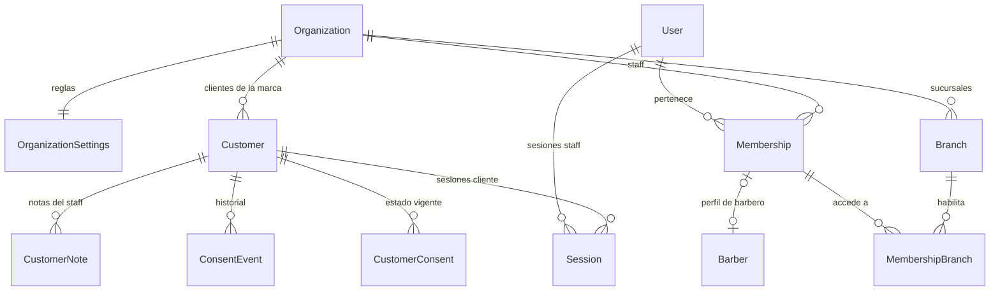
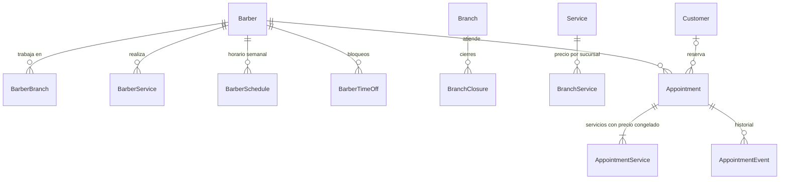
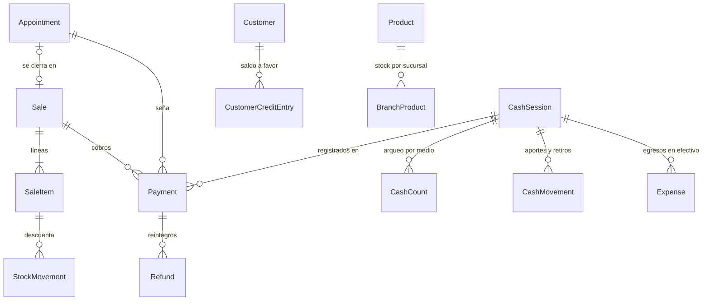
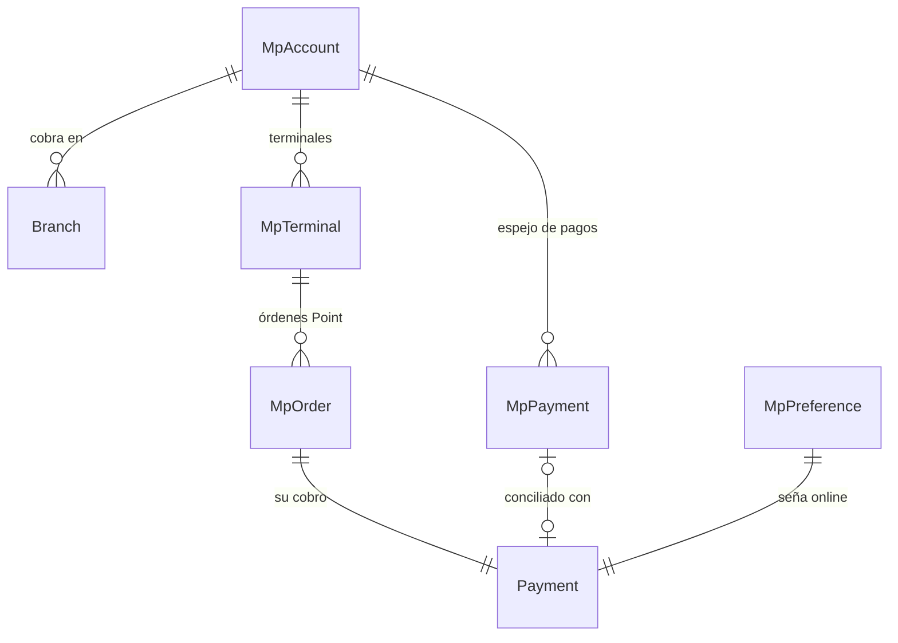
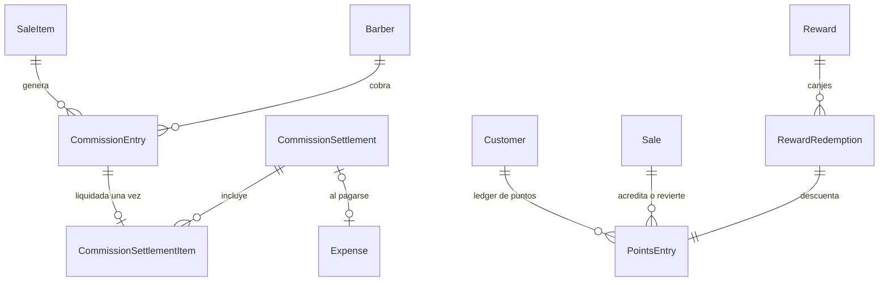
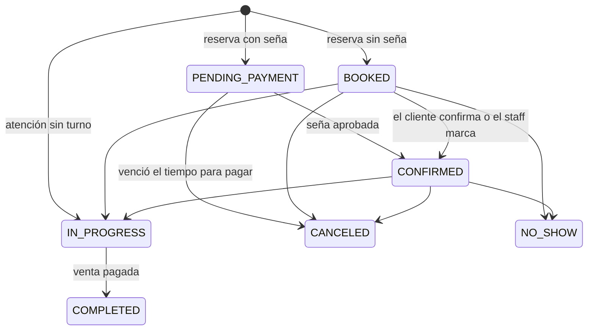
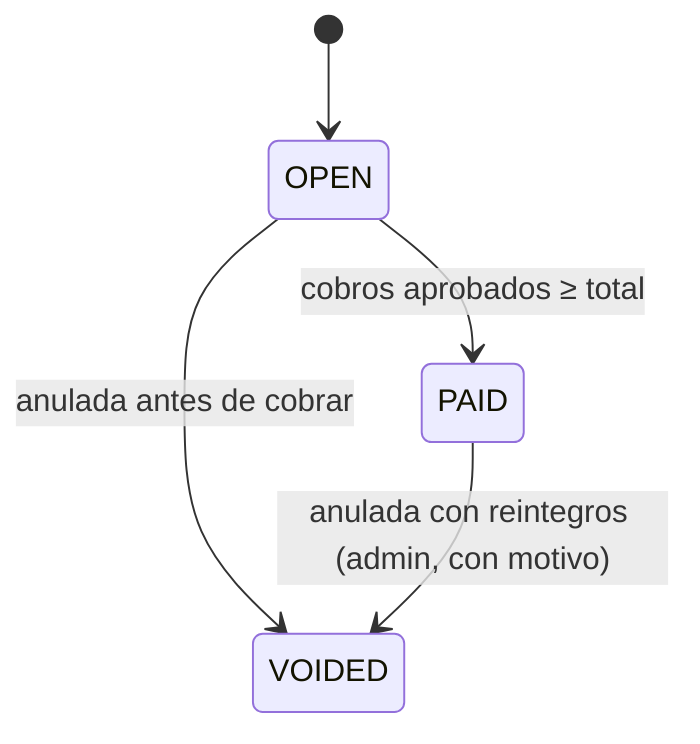

# 02 · Modelo de datos

> Schema completo: [schema.prisma](schema.prisma) (58 tablas, 50 enums, comentado en español). Lo que Prisma no puede expresar está en [extra.sql](extra.sql). Las pruebas de las reglas, en [verificacion-db.sql](verificacion-db.sql).

## 1. Convenciones

| Tema           | Regla                                                                                                                                               |
| -------------- | --------------------------------------------------------------------------------------------------------------------------------------------------- |
| Nombres        | Código en inglés (`Appointment`), comentarios en español. Tablas y columnas en snake_case (`appointments.starts_at`).                               |
| IDs            | UUID v7.                                                                                                                                            |
| Dinero         | `BigInt` en **centavos** de ARS, sufijo `Cents` (`$15.000` = `1500000`). Nunca decimales.                                                           |
| Porcentajes    | Puntos básicos (bps): `4500` = 45 %.                                                                                                                |
| Fechas         | `timestamptz` en UTC. Las fechas "de negocio" (día de caja, período de liquidación) usan `date`.                                                    |
| Multi-sucursal | Toda tabla operativa lleva `organization_id` y `branch_id`. **Clientes, puntos y saldo a favor** pertenecen a la organización.                      |
| Borrado        | Lo operativo no se borra: se desactiva (`active`, `archived_at`), se anula con motivo (`voided_*`) o se anonimiza (clientes).                       |
| Ledgers        | Puntos, saldo a favor, stock, comisiones, auditoría, consentimientos e historial de turnos son **solo inserción**. La base bloquea UPDATE y DELETE. |
| Idempotencia   | Los ledgers y los envíos tienen `idempotency_key` o `dedupe_key` **únicas**: reintentar nunca duplica.                                              |

## 2. Mapa de dominios

| Dominio                      | Tablas                                                                                                                      |
| ---------------------------- | --------------------------------------------------------------------------------------------------------------------------- |
| Organización y configuración | `organizations`, `organization_settings`, `branches`, `branch_closures`, `sequence_counters`                                |
| Identidad y acceso           | `users`, `memberships`, `membership_branches`, `sessions`, `auth_codes`                                                     |
| Clientes                     | `customers`, `customer_notes`, `customer_consents`, `consent_events`                                                        |
| Equipo y horarios            | `barbers`, `barber_branches`, `barber_services`, `barber_schedules`, `barber_time_offs`                                     |
| Catálogo y stock             | `service_categories`, `services`, `branch_services`, `product_categories`, `products`, `branch_products`, `stock_movements` |
| Agenda                       | `appointments`, `appointment_services`, `appointment_events`                                                                |
| Ventas y cobros              | `sales`, `sale_items`, `payments`, `refunds`, `customer_credit_entries`                                                     |
| Mercado Pago                 | `mp_accounts`, `mp_terminals`, `mp_orders`, `mp_payments`, `mp_preferences`, `webhook_events`                               |
| Caja y egresos               | `cash_sessions`, `cash_counts`, `cash_movements`, `expense_categories`, `expenses`                                          |
| Comisiones                   | `commission_entries`, `commission_settlements`, `commission_settlement_items`                                               |
| Puntos                       | `points_entries`, `rewards`, `reward_redemptions`                                                                           |
| Notificaciones               | `notification_type_settings`, `notifications`                                                                               |
| Sistema                      | `audit_logs`, `system_alerts`, `worker_heartbeats`, `job_runs`, `api_idempotency_keys`                                      |

## 3. Diagramas por dominio

### Organización, acceso y clientes

- **Roles:**
  - **Dueño** = `ADMIN` con `all_branches = true`.
  - **Encargado** = `ADMIN` limitado a las sucursales de `membership_branches`.
  - **Barbero** = `BARBER`.
- **Quién atiende:** el perfil `Barber` es independiente del rol. Un dueño que corta es `ADMIN` + `Barber`, y puede existir un barbero sin usuario (el admin maneja su agenda).

### Agenda

### Ventas, cobros, caja y stock

### Mercado Pago

`mp_payments` es un **espejo de todo lo que entra a la cuenta**, llegue por webhook o por el sync. `payments` son **nuestros cobros**. La conciliación garantiza que cada pago aprobado de MP termine vinculado a un cobro, marcado como "otro ingreso" o ignorado con motivo.

### Comisiones y puntos

## 4. Ciclos de vida

### Turno

- `PENDING_PAYMENT`, `BOOKED`, `CONFIRMED` e `IN_PROGRESS` **ocupan el horario**. `CANCELED`, `NO_SHOW` y `COMPLETED` no.
- Revertir un ausente es posible (admin, con auditoría).
- El contador de ausencias de la ficha es la cantidad de turnos `NO_SHOW` del cliente.

**Estado de la seña** (`deposit_status`): `NOT_REQUIRED` → `PENDING` → `PAID` → `APPLIED` (usada en la venta). Si no, termina en `REFUNDED` / `CREDITED` (cancelación a tiempo), `RETAINED` (tarde o ausente) o `EXPIRED` (no la pagó).

### Venta y cobro

Cobro: `PENDING` → `APPROVED` | `REJECTED` | `CANCELED` | `EXPIRED`, y después `PARTIALLY_REFUNDED` | `REFUNDED`.

## 5. Qué garantiza la base (aunque la aplicación tenga un error)

| Regla                                                                                                        | Mecanismo                                               |
| ------------------------------------------------------------------------------------------------------------ | ------------------------------------------------------- |
| Un barbero no tiene dos turnos activos que se pisen (en ninguna sucursal)                                    | `EXCLUDE USING gist` sobre barbero + rango horario      |
| Una sola caja abierta por sucursal                                                                           | Índice único parcial                                    |
| Una sola orden Point en espera por terminal (regla de MP)                                                    | Índice único parcial                                    |
| Una sola alerta abierta por problema                                                                         | Índice único parcial                                    |
| Un pago de MP respalda como máximo un cobro                                                                  | `payments.mp_payment_id` único                          |
| Un webhook no se procesa dos veces                                                                           | `UNIQUE(provider, event_key)`                           |
| Puntos, comisiones y saldo a favor no se acreditan dos veces                                                 | `idempotency_key` únicas                                |
| Una comisión no se liquida dos veces                                                                         | `commission_settlement_items.commission_entry_id` único |
| Un recordatorio no se envía dos veces                                                                        | `notifications.dedupe_key` única                        |
| Ledgers inmutables                                                                                           | Trigger que rechaza UPDATE y DELETE                     |
| Montos coherentes (total = subtotal − descuento; total de línea = cantidad × precio − descuento; montos > 0) | CHECKs                                                  |
| Signos correctos (una venta resta stock, un canje resta puntos, una acreditación suma)                       | CHECKs por tipo                                         |
| Ajustes manuales de stock, puntos y saldo siempre con motivo                                                 | CHECKs                                                  |
| Cada cobro está vinculado según su propósito (venta, seña, saldo, otro ingreso)                              | CHECKs                                                  |
| Datos de contacto normalizados (email en minúsculas, teléfono E.164, DNI solo dígitos)                       | CHECKs                                                  |
| Configuración de seña coherente (fija o %, nunca las dos)                                                    | CHECK                                                   |
| `external_reference` válida para MP (≤ 64, `[A-Za-z0-9_-]`)                                                  | CHECK                                                   |

## 6. Valores derivados (se calculan, no se editan)

| Dato                           | Cómo se obtiene                                                                                                                                                     |
| ------------------------------ | ------------------------------------------------------------------------------------------------------------------------------------------------------------------- |
| Saldo de puntos                | `SUM(points_entries.points)` del cliente                                                                                                                            |
| Saldo a favor                  | `SUM(customer_credit_entries.amount_cents)`                                                                                                                         |
| Stock actual                   | `branch_products.stock_on_hand`. Es una proyección que se actualiza **en la misma transacción** que cada movimiento; se puede recalcular sumando `stock_movements`. |
| Pagado de una venta            | `sales.paid_cents`, que se recalcula en la transacción de cada cobro                                                                                                |
| Esperado de caja               | Fórmula de [01-arquitectura.md §8](01-arquitectura.md)                                                                                                              |
| Ausencias del cliente          | Cantidad de turnos `NO_SHOW`                                                                                                                                        |
| Clientes nuevos vs recurrentes | `customers.first_visit_at`                                                                                                                                          |

## 7. Preparado para lo que viene (sin construirlo ahora)

| Futuro                   | Qué ya está listo                                                                                                                                       | Qué se agregaría                                                                                |
| ------------------------ | ------------------------------------------------------------------------------------------------------------------------------------------------------- | ----------------------------------------------------------------------------------------------- |
| **Franquicias**          | Encargado = ADMIN limitado a sus sucursales; cada sucursal puede cobrar con **su propia cuenta de MP** (`branches.mp_account_id`); OAuth de MP modelado | Tabla de franquiciados o razón social, regalías, UI                                             |
| **Varias marcas (SaaS)** | Todo cuelga de `organization_id`; slugs por organización; cookies atadas al dominio                                                                     | Dominios por organización, RLS de Postgres, alta de organizaciones                              |
| **Facturación ARCA**     | La venta tiene líneas con precios congelados y cliente                                                                                                  | Tabla `invoices` (1 a 1 con la venta), razón social y CUIT por sucursal, punto de venta de ARCA |
| **Membresías**           | Los propósitos de cobro y los tipos de línea son enums extensibles                                                                                      | Planes, suscripciones del cliente, consumo de servicios del plan                                |
| **App nativa**           | La API es independiente de la web y se documenta con OpenAPI                                                                                            | Autenticación por token para mobile                                                             |
| **Marketplace**          | Organización y sucursal con slug, página pública de reservas                                                                                            | Directorio público                                                                              |

## 8. Glosario (español → código)

| Negocio                      | Modelo                            |     | Negocio              | Modelo                             |
| ---------------------------- | --------------------------------- | --- | -------------------- | ---------------------------------- |
| Marca                        | `Organization`                    |     | Caja                 | `CashSession`                      |
| Sucursal                     | `Branch`                          |     | Arqueo               | `CashCount`                        |
| Dueño / encargado / barbero  | `Membership.role` + `allBranches` |     | Aporte / retiro      | `CashMovement`                     |
| Barbero (quien atiende)      | `Barber`                          |     | Egreso, gasto        | `Expense`                          |
| Cliente                      | `Customer`                        |     | Comisión             | `CommissionEntry`                  |
| Turno                        | `Appointment`                     |     | Liquidación          | `CommissionSettlement`             |
| Ausente                      | `NO_SHOW`                         |     | Puntos               | `PointsEntry`                      |
| Bloqueo del barbero          | `BarberTimeOff`                   |     | Recompensa           | `Reward`                           |
| Cierre de sucursal (feriado) | `BranchClosure`                   |     | Canje                | `RewardRedemption`                 |
| Venta                        | `Sale`                            |     | Terminal Point       | `MpTerminal`                       |
| Línea de venta               | `SaleItem`                        |     | Orden Point          | `MpOrder`                          |
| Cobro                        | `Payment`                         |     | Pago de la cuenta MP | `MpPayment`                        |
| Seña                         | cobro con `purpose = DEPOSIT`     |     | Pago sin asignar     | `MpPayment` con `UNASSIGNED`       |
| Reintegro                    | `Refund`                          |     | Consentimiento       | `CustomerConsent` / `ConsentEvent` |
| Saldo a favor                | `CustomerCreditEntry`             |     | Auditoría            | `AuditLog`                         |
| Propina                      | línea `TIP`                       |     | Alerta del sistema   | `SystemAlert`                      |

## 9. Verificación realizada (25/09/2026)

Con **Prisma 7.10.0** y **PostgreSQL 16.13** locales:

1. `prisma validate` y `prisma format`: el schema es válido.
2. `prisma generate`: el cliente se genera sin errores.
3. La migración (SQL de Prisma + `extra.sql`) se aplica en una base vacía. Quedan 58 tablas, 1 restricción de exclusión, 64 CHECKs y 7 triggers.
4. **Sin drift:** `prisma migrate diff` (contra el historial de migraciones y contra la base real) devuelve "empty migration". Prisma **no intenta borrar** lo agregado a mano. Los índices parciales se declaran en el schema (preview `partialIndexes`, disponible desde Prisma 7.4) justamente para que Prisma los conozca.
5. **41 pruebas de reglas** ([verificacion-db.sql](verificacion-db.sql)): todas aceptan o rechazan según lo esperado.
6. **Concurrencia real:** dos reservas simultáneas del mismo horario dejan siempre 1 turno. Los resultados están en [01-arquitectura.md §7](01-arquitectura.md).

**Pendiente de verificar en Railway (Fase 1):** que la extensión `btree_gist` esté disponible en su Postgres. Es un módulo estándar de PostgreSQL, pero Railway no lo lista explícitamente.
